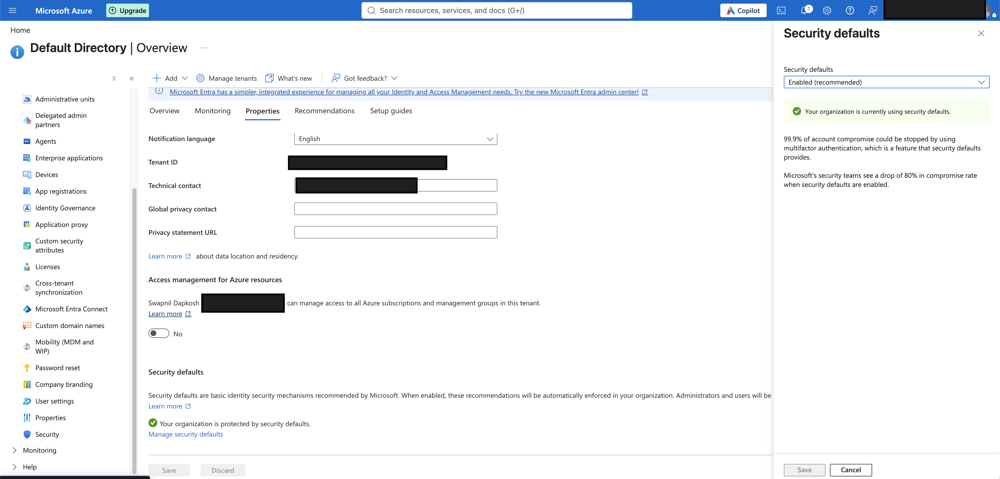
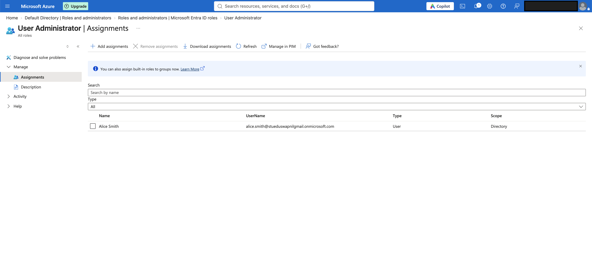
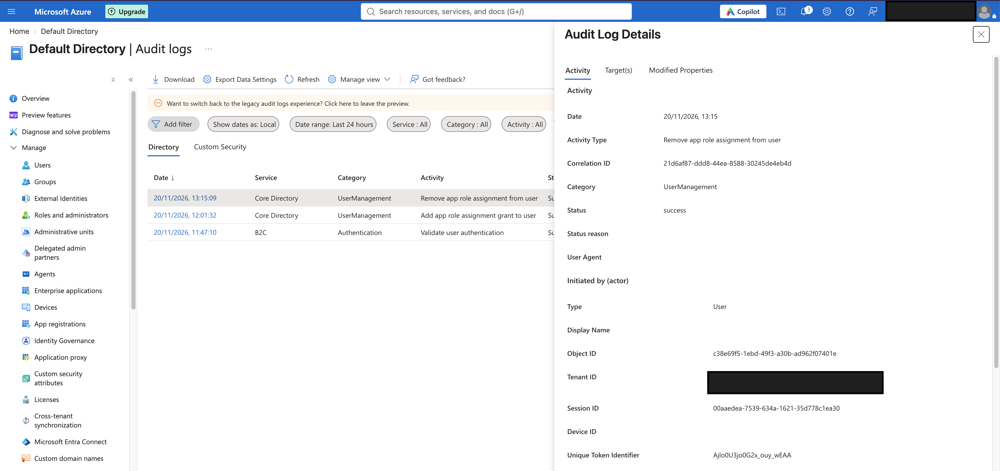

# Enterprise Identity & Access Governance in Microsoft Entra ID

A hands-on Identity and Access Management (IAM) governance lab and security assessment built in **Microsoft Entra ID (Free Tier)**[cite: 6]. This project models Joiner-Mover-Leaver (JML) lifecycle operations, enforces Least-Privilege Role-Based Access Control (RBAC), validates baseline Multi-Factor Authentication (MFA) hardening, and verifies offboarding non-repudiation through directory audit logs[cite: 6, 7, 8, 9].

📄 **[Read the Full Case Study & Risk Assessment Report (PDF)](docs/Entra-ID-IAM-Governance-Case-Study.pdf)**

---

## Project Overview & Architecture

* **Environment:** Microsoft Entra ID (Free Tier)[cite: 6]
* **Departmental Personas & Groups:** Modeled role-separated identities for **Alice Smith (HR)** and **Bob Jones (Finance)** alongside a dedicated security group (`SG-Finance-Access`) and enterprise application (`Finance-App-Prod`)[cite: 6].
* **Least-Privilege RBAC:** Delegated scoped user administration to a non-global administrator via the built-in **User Administrator** role, eliminating standing **Global Administrator** over-provisioning[cite: 7].
* **Baseline Tenant Hardening:** Enabled and verified **Security Defaults** to enforce tenant-wide MFA registration for administrators and block legacy authentication protocols (POP3, IMAP, SMTP) without requiring P1/P2 licenses[cite: 7].
* **Leaver Offboarding & Audit Telemetry:** Simulated employee offboarding by revoking application role assignments on `Finance-App-Prod` and verified non-repudiation in Entra ID Audit Logs[cite: 8, 9].

---

## Evidence & Visual Walkthrough

### 1. Baseline Tenant Hardening (Security Defaults & MFA)
Enabled **Security Defaults** in Microsoft Entra ID to enforce tenant-wide Multi-Factor Authentication (MFA) for administrators and block legacy authentication protocols (POP3, IMAP, SMTP).


### 2. Least-Privilege RBAC Delegation
Delegated scoped user administration using the built-in **User Administrator** role instead of assigning standing **Global Administrator** privileges.


### 3. Leaver Offboarding & Audit Log Verification
Revoked application role assignments on `Finance-App-Prod` during simulated offboarding and verified non-repudiation via Entra ID Directory Audit Logs.


---

## Repository Structure

```text
entra-id-iam-governance-lab/
├── README.md
├── docs/
│   └── Entra-ID-IAM-Governance-Case-Study.pdf
└── assets/
    ├── 01-tenant-security-defaults.png
    ├── 02-rbac-least-privilege.png
    └── 03-audit-log-offboarding.png
```
---

## Related IAM Lab
* **[Microsoft Entra ID: JML & Access Drift Remediation Lab](https://github.com/gitswapnil1/entra-id-jml-access-drift-lab):** Companion lab simulating privilege creep during a cross-departmental transfer (`Finance → HR`), manual entitlement cleanup across apps and security groups, and full offboarding audit verification.
